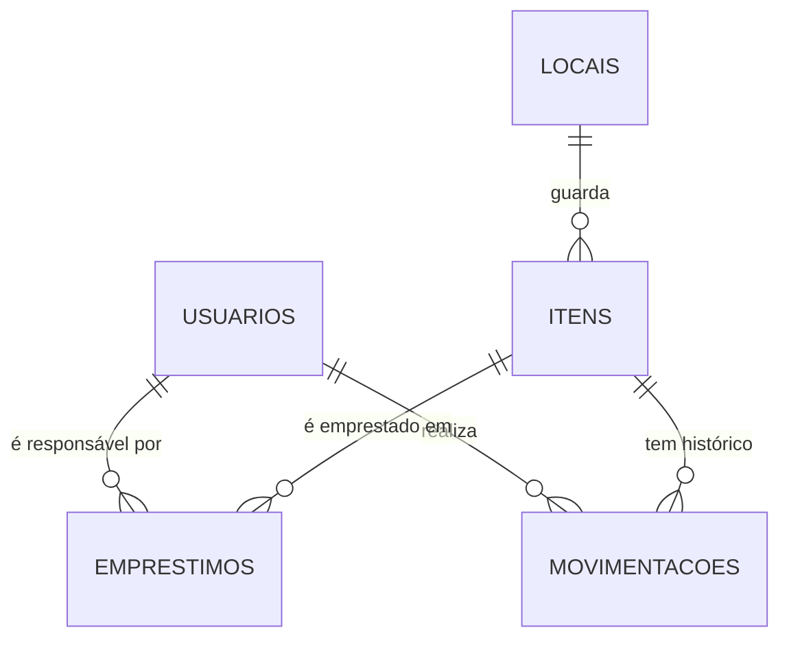

# ADR 001 — Modelagem dos dados

**Status:** Aceita · **Data:** 28/09 · **Revisada:** 28/10 (detalhamento das coleções, campos, identificadores e exclusão lógica)

## Resumo

No contexto de um aplicativo de inventário para laboratórios, diante da necessidade de organizar usuários, locais, itens, empréstimos e movimentações em um banco NoSQL (Firestore) espelhado em um banco local (SQLite), decidimos por **cinco coleções na raiz, relacionadas por identificadores, com cópia proposital de nomes (desnormalização) e exclusão lógica**, para alcançar consultas baratas e um histórico legível, aceitando que nomes copiados podem ficar desatualizados e que o saldo do item precisa ser mantido em transação.

## Contexto

O sistema precisa armazenar diferentes tipos de informações e relacionamentos. Um item pode possuir vários empréstimos e movimentações, enquanto um usuário pode ser responsável por diversos empréstimos.

Restrições que influenciam a modelagem:

- O **Firestore não faz JOIN**: cada documento de outra coleção lido para montar uma tela custa uma leitura da cota gratuita (≤ 50.000/dia, RNF18).
- A mesma estrutura precisa existir no **SQLite** (cache local, [ADR-002](ADR-002-Persistencia-local-remota.md)) e ser sincronizada de forma incremental ([ADR-003](ADR-003-Sincronização-dos-dados.md)).
- O histórico é **imutável** (RNF20) e precisa continuar legível mesmo depois que um item for excluído.

## Alternativas consideradas

| # | Alternativa | Por que não |
|---|---|---|
| A | Uma única estrutura (item com empréstimos e movimentações dentro) | Duplica dados, o documento cresce sem limite (o Firestore tem limite de 1 MB por documento) e não permite listar "todos os empréstimos atrasados" sem ler todos os itens |
| B | Entidades separadas, **totalmente normalizadas** (só IDs) | Para mostrar o histórico com nome do item e do usuário, cada linha exigiria mais 2 leituras. 20 linhas = 60 leituras |
| C | Entidades separadas em **subcoleções** (`itens/{id}/movimentacoes`) | O painel precisa de "movimentações recentes de todos os itens", o que exigiria consultas `collectionGroup` e índices extras |
| **D** | **Entidades separadas em coleções na raiz, com desnormalização de nomes** | **Escolhida** |

## Solução

### Diagrama



### Coleções e campos

Os nomes são iguais no Firestore (coleção) e no SQLite (tabela).

**`usuarios`** — o ID do documento é o `uid` do Firebase Authentication.

| Campo | Tipo | Observação |
|---|---|---|
| nome | texto | |
| email | texto | |
| perfil | `admin` \| `tecnico` \| `estudante` | Sempre `estudante` no cadastro ([ADR-008](ADR-008-Atribuicao-de-perfis.md)) |
| ativo | booleano | Desativado pelo Admin (RF05) |
| diasAlertaValidade | número | Padrão 30, entre 7 e 180 (RNF21) |
| notificacoesAtivas | booleano | RF20 |
| criadoEm, updatedAt | data/hora | |

**`locais`**

| Campo | Tipo | Observação |
|---|---|---|
| sala, armario, prateleira | texto | |
| descricao | texto | Montado ao salvar: "Sala 2 › Armário 3 › Prateleira B" |
| arquivado | booleano | Exclusão lógica |
| updatedAt | data/hora | |

**`itens`**

| Campo | Tipo | Observação |
|---|---|---|
| tipo | `reagente` \| `vidraria` \| `equipamento` | |
| nome | texto | |
| nomeBusca | texto | Nome em minúsculas e sem acentos, para a busca parcial (RF22) |
| concentracao, fabricante, lote, cas, observacoes | texto | Opcionais |
| validade | texto `AAAA-MM-DD` ou nulo | Obrigatória para reagentes |
| quantidade | número | **Saldo disponível** (ver decisão 4) |
| unidade | texto | frasco, litro, unidade, caixa… |
| estoqueMinimo | número ou nulo | RF21 |
| localId | ID | → `locais` |
| localDescricao | texto | **Cópia** de `locais.descricao` |
| origem | `manual` \| `ia` | Se o cadastro partiu de uma sugestão da IA |
| arquivado | booleano | Exclusão lógica (RF11) |
| criadoPor, criadoEm, updatedAt | | |

**`emprestimos`**

| Campo | Tipo | Observação |
|---|---|---|
| itemId, itemNome | ID + **cópia** | |
| usuarioId, usuarioNome | ID + **cópia** | |
| quantidade | número | |
| finalidade | texto | Aula prática, Pesquisa IC, Análise de rotina |
| dataRetirada, dataPrevista | data | |
| dataDevolucao | data ou nulo | **Nulo = empréstimo aberto** |
| updatedAt | data/hora | |

**`movimentacoes`** — somente inclusão; nunca é alterada nem apagada (RNF20).

| Campo | Tipo | Observação |
|---|---|---|
| itemId, itemNome | ID + **cópia** | |
| usuarioId, usuarioNome | ID + **cópia** | |
| tipo | `cadastro` \| `edicao` \| `retirada` \| `devolucao` \| `consumo` \| `exclusao` | |
| quantidade | número ou nulo | |
| observacao | texto | Ex.: "sugestão IA confirmada", "devolvido com atraso de 3 dias" |
| dataHora | data/hora | |

### Decisões de detalhe

1. **Coleções na raiz** (alternativa D): permitem consultar "todos os empréstimos atrasados" ou "últimas movimentações" com uma única consulta.
2. **Desnormalização**: `itemNome`, `usuarioNome` e `localDescricao` são copiados no momento da gravação. O histórico e as listas são exibidos sem leituras extras.
3. **Exclusão lógica** (`arquivado = true`) em itens e locais: o item some das listas, mas o histórico continua apontando para ele. É também o que permite que a exclusão chegue aos outros aparelhos na sincronização ([ADR-003](ADR-003-Sincronização-dos-dados.md)).
4. **Saldo armazenado no item** (e não calculado somando movimentações): a lista mostra a quantidade sem ler o histórico. Toda operação que altera o saldo grava o item, o empréstimo e a movimentação **na mesma transação**.
5. **IDs gerados no app** (UUID via `expo-crypto`): o mesmo ID é usado no SQLite e no Firestore, sem tabela de conversão. Exceção: `usuarios`, que usa o `uid` do Firebase Authentication.
6. **Validade como texto `AAAA-MM-DD`**: uma data sem horário não sofre deslocamento de fuso. Em JavaScript, `new Date('2026-11-03')` é interpretado como meia-noite em UTC, que em Brasília (UTC−3) é 21h do dia **02/11**; guardar como objeto de data faria a validade aparecer um dia antes.
7. **Status do item não é armazenado**: "Vencido", "Vencendo", "Emprestado" e "Abaixo do mínimo" são calculados a partir de `validade`, `quantidade`, `estoqueMinimo` e dos empréstimos abertos. Assim, nunca ficam desatualizados.

### Exemplo de documento (`itens`)

```json
{
  "id": "7f3c2a9e-1b4d-4e8a-9c21-5d0f6b8e2a17",
  "tipo": "reagente",
  "nome": "Acetona PA 99,5%",
  "nomeBusca": "acetona pa 99,5%",
  "concentracao": "99,5%",
  "fabricante": "Synth",
  "lote": "A2291",
  "cas": "67-64-1",
  "validade": "2026-11-03",
  "quantidade": 3,
  "unidade": "frasco",
  "estoqueMinimo": 2,
  "localId": "c1e8b7d2-0a4f-4b6e-8d3a-2f9e7c5b1a60",
  "localDescricao": "Sala 2 › Armário de Inflamáveis › Prateleira B",
  "origem": "ia",
  "arquivado": false,
  "criadoPor": "uid-tecnico-joao",
  "criadoEm": "2026-10-28T14:15:00Z",
  "updatedAt": "2026-10-29T08:30:00Z"
}
```

## Consequências

- **Ganho:** Listas e histórico são exibidos com **uma consulta cada**, o que economiza cota do Firestore.
- **Ganho:** O histórico continua legível mesmo após o item ser excluído ou renomeado.
- **Ganho:** A mesma estrutura serve ao SQLite e ao Firestore, sem conversão de IDs.
- **Custo:** Se um item for **renomeado**, as movimentações antigas mantêm o nome antigo. Aceitamos isso porque o histórico deve registrar como o item se chamava naquele momento.
- **Custo:** Se a descrição de um **local** mudar, `localDescricao` precisa ser atualizada nos itens daquele local (uma gravação em lote).
- **Custo:** O saldo depende de **todas** as operações usarem transação; essa regra fica centralizada na camada de serviços ([ADR-004](ADR-004-Arquitetura-em-camadas.md)).
